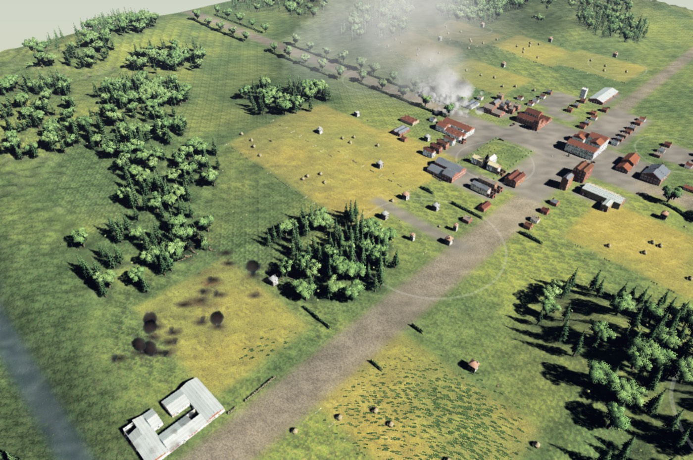

# Tactical Command — Normandy

A real-time tactics game of WW2 combined arms in the spirit of Close Combat,
drawn at true scale: squads, tanks, guns, towns and rivers at their real sizes,
with first-person control of any unit on the field.

**Play it here: https://bghryct.github.io/TacticalCommand/**

It runs in the browser with nothing to install. There are seven campaigns,
ninety-six battlefields and a content editor (`editor.html`).

- The scale models download as a battle needs them: about 25 MB for the opening
  battle, then only the models each new map fields. Tanks may show as plain
  shapes for a moment, and your browser keeps the models after that.
- A desktop browser such as Chrome, Edge or Firefox works best.
- Multiplayer needs the local relay server and is not available on the web page.

## Credits

- Built with [three.js](https://threejs.org/) (MIT licence).
- The vehicle, gun and figure models, buildings, terrain and ground textures
  were made for this game.
- The sounds come from the USC Sound Effects Library on archive.org (CC0), from
  *The Designer's Choice UCS Collection: VOICES* by Nicholas Judy (CC0), and
  from freesound.org under CC BY 4.0 and CC0. Each clip is credited on the
  [landing page](https://bghryct.github.io/TacticalCommand/) and in
  [assets/audio/README.md](assets/audio/README.md).
